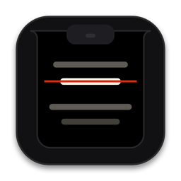
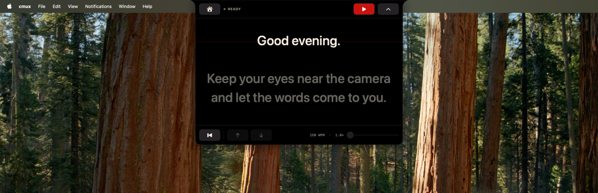
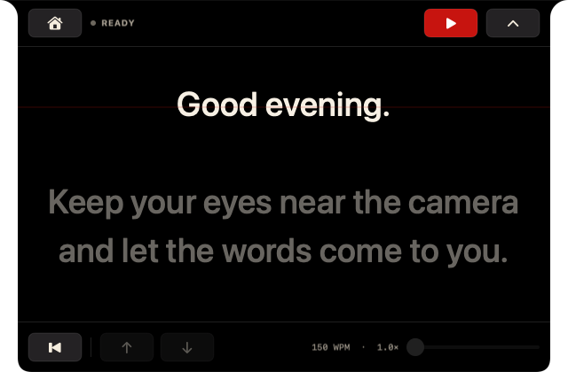
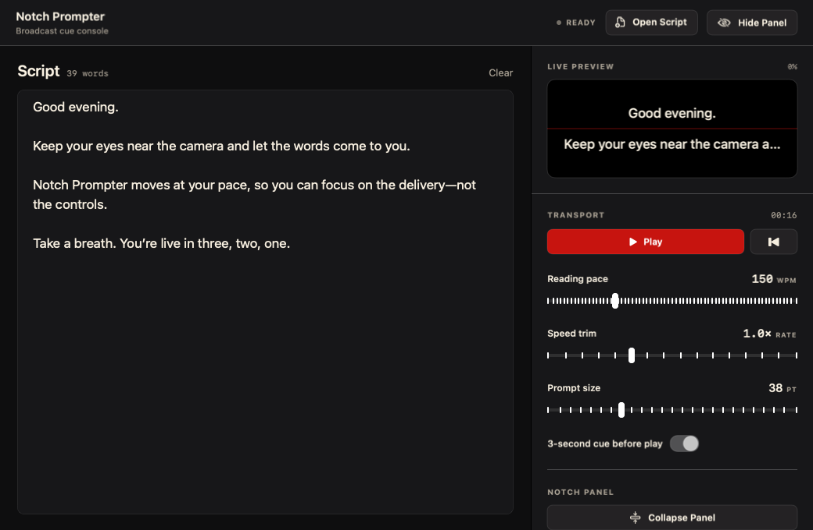

<div align="center">



# Notch Prompter

**A teleprompter that hangs from your MacBook's notch.**

Your script scrolls a few centimeters below the camera, so you can read it and
still look at the person on the other end.


<br>



</div>

---

## Why the notch?

A floating teleprompter window goes wherever there's room on screen. That's
rarely next to the camera, and viewers notice when your eyes keep drifting to
one side.

The notch is the one spot on a MacBook that is always right beside the lens.
Notch Prompter's panel grows down from it, so the line you're reading sits
directly under the camera. On a display without a notch, the panel becomes a
centered pill at the top of the screen.

## Features

<table>
<tr>
<td width="50%" valign="top">

### A reading guide near the lens

A thin red guide line sits 22% of the way down the prompt. The line you're on
is warm white and everything else is dimmed. The app tracks each wrapped line
on its own, so a long sentence that spans two lines still highlights one line
at a time.

</td>
<td width="50%" valign="top">



</td>
</tr>
<tr>
<td width="50%" valign="top">


</td>
<td width="50%" valign="top">

### A countdown before you start

Press play and the notch shows a red 3-2-1 before the script moves. Between
takes, collapse the panel into a slim pill. Play and expand stay in it.

</td>
</tr>
</table>

### An editor for setup



- **Bring any script.** Paste it, open it, or drop a `.txt`, `.md`, or
  `.markdown` file onto the editor. The app converts Markdown to plain text.
- **Set the pace in words per minute.** A speed trim multiplier fine-tunes it,
  and the transport shows the total run time.
- **Size the text** for your screen and how far back you sit.
- **Check the live preview.** It shows the same lines the notch will.

### Fix your place mid-read

- Scroll over the prompt with a mouse or trackpad. Scrolling pauses playback
  so the auto-scroll doesn't pull the text away from you.
- Step one line up or down with the footer arrows, or drag the progress
  slider to jump farther.
- Press Reset to go back to the top.

### One shortcut from any app

Press **⌘⇧P** to play or pause while your recording or call app has focus.
Notch Prompter registers the hotkey through macOS's hotkey API. It doesn't
read your keystrokes, and it doesn't need Accessibility or Input Monitoring
permission.

The caption icon in the menu bar can also open the editor or panel and control
playback while the editor is hidden.

---

## Getting started

### Requirements

- macOS 14 Sonoma or newer
- Apple Command Line Tools with Swift 6. I've tested it with Swift 6.1.2. You
  don't need full Xcode.

```bash
swift --version
```

### Run from source

```bash
swift run NotchPrompterApp
# or
./scripts/run.sh
```

The first build takes a little longer. The editor opens with a sample script,
so you can press **⌘⇧P** right away.

### Build a local `.app`

You don't need an Xcode project:

```bash
./scripts/build-app.sh
open "dist/Notch Prompter.app"
```

The script builds for your Mac's architecture, checks the executable with
`lipo`, and assembles this bundle:

```text
dist/Notch Prompter.app/
└── Contents/
    ├── Info.plist
    ├── MacOS/NotchPrompter
    └── Resources/AppIcon.icns
```

The bundle is unsigned and unnotarized, and it only runs on the architecture
that built it. An Apple silicon Mac produces `arm64` and an Intel Mac produces
`x86_64`, so build once on each kind of Mac you want to share with. If macOS
quarantines a copied bundle, Control-click it in Finder and choose **Open**.

---

## Development

```bash
swift test                  # Markdown conversion, playback math, panel geometry
swift build                 # debug build
swift build -c release      # release build
```

**UI snapshots.** This script renders the shipping SwiftUI views to PNG
without launching the interactive app:

```bash
./scripts/capture-ui.sh
```

It writes three files to `.impeccable/review/`:

- `editor.png` at 1040×680
- `prompter-panel.png` at 640×420
- `prompter-panel-collapsed.png` at 548×50

The images in `docs/screenshots/` come from these snapshots.

**App icon.** After you change the icon's vector drawing, regenerate the full
macOS icon set:

```bash
./scripts/generate-app-icon.sh
```

## Known limitations

- If another running app has already claimed **⌘⇧P**, the shortcut won't
  work. Play/Pause is still in the app menu and the status menu.
- The panel appears on whichever display the editor is on. On a notched
  screen it works out the camera gap from `safeAreaInsets` and the auxiliary
  top areas. Other displays get a centered pill at the top.
- "Always on top" uses a status-bar-level panel that joins every Space and can
  sit beside full-screen windows. macOS and some exclusive full-screen apps can
  still draw protected content over it.
- The Markdown conversion is conservative. It drops complex tables and
  embedded media.
- The app doesn't save settings or scripts between launches yet.
